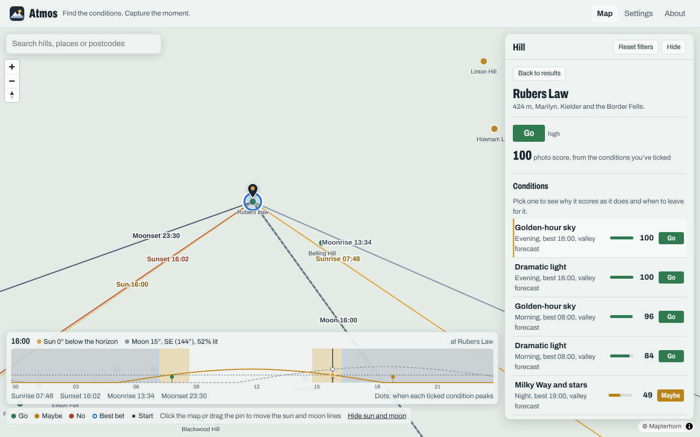
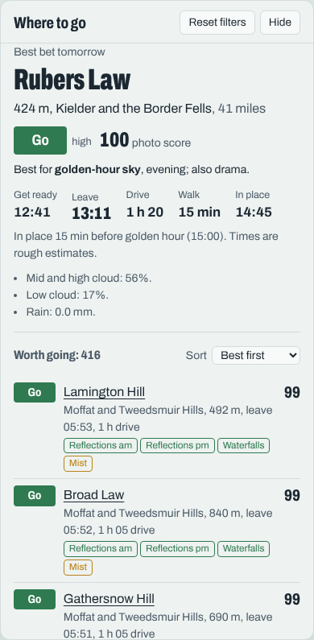

<p align="center">
  
</p>

<h1 align="center">Atmos</h1>

<p align="center"><strong>Find the conditions. Capture the moment.</strong></p>

<p align="center">
  Where to go in the UK for landscape photography and hill walking over the next five days,<br>
  when to leave, and why.
</p>

<p align="center">
  
</p>

> **A guide, not a safety service.** Always check the [Met Office mountain forecast](https://www.metoffice.gov.uk/weather/specialist-forecasts/mountain)
> and [MWIS](https://www.mwis.org.uk/) before going onto the hills.

## What it does

- **Scores every hill for every condition.** About 2,200 UK hills (Munros, Corbetts, Grahams,
  Donalds, Hewitts, Nuttalls, Wainwrights and Marilyns) are scored morning, daytime, evening and
  night, from Met Office and ECMWF forecasts.
- **Ranks them by a photo score.** Tick the conditions and times you care about; each hill gets
  a score out of 100 from its best three, and the list sorts best to worst. The best bet is ringed
  on the map.
- **Explains every verdict.** Pick a hill to see each condition with its weather reasons, how
  closely the models agree, and the air above the valley.
- **Works out the walk up.** For the hill you open and the top results, Atmos finds the quickest
  way up from a car park or road along OpenStreetMap paths, reads the height profile from terrain
  data and times it by Naismith's rule with Langmuir's corrections. The route is drawn on the map,
  and the leave time and Google Maps directions use its start.
- **Plans the trip.** Set a home, say what to be there for (blue hour, golden hour, sunrise or
  sunset), the earliest you'll get up and how far you'll drive. Each hill gets a rough get-up and
  leave time, with a Google Maps link for the real route.
- **Warns about plane trails.** Where a clean sky matters (clear air, golden-hour sky, drama,
  alpenglow, and less so inversions, reflections and wave cloud), each condition shows the risk
  of trails lingering at its best hour. It's worked out from the air where planes cruise (300 to
  200 hPa, from ECMWF): whether it's cold enough for trails to form, saturated enough with ice
  for them to linger and spread, and clear enough to see them. Upper-air humidity is hard to
  forecast, so it never changes a verdict. "Avoid plane trails" ranks risky places and times
  lower instead. The alerts container also samples aircraft above 25,000 ft over the UK from the
  OpenSky Network every 12 minutes, building up when and where they fly, to sharpen this later.
- **Plans hill walks.** With Walking ticked, "Your trip" asks when to start walking (when the
  weather's best, or a set time) and when to be back down (before sunset, before dark, or any
  time). Atmos tries each start time and judges walking over just the hours you'd be on the hill,
  up and down, so the verdict is for the walk you'd do. Morning walks set off from first light,
  evening walks finish around sunset, and any walk that would end after sunset or dark says to
  take a head torch.
- **Shows the sun and moon.** A draggable pin draws sunrise, sunset, moonrise and moonset bearings;
  the timeline adds the sun and moon now, and you scrub it through the day.
- **Lines the sun or moon up with a summit.** "Line it up" in a hill's panel works out, from
  terrain heights, where to stand for the sun or moon to sit right on top, a few minutes at a
  time through the day. The spots show on the map with times, skipping any where nearer ground
  hides the summit, each with directions.
- **Maps the aurora.** With Aurora ticked, tonight's NOAA OVATION nowcast is shaded over the UK,
  and each night has a view line from the Kp forecast showing how far south it should reach.
- **Checks itself.** Three models (Met Office, ECMWF and, for the first two and a half days,
  KNMI's HARMONIE): a Go needs most of them to agree. Sunrise and sunset conditions check the
  cloud 60 km towards the sun, and each hill's panel shows how many runs of the ECMWF (51) and
  Met Office (18) ensembles back the forecast.
- **Finds anywhere.** Search hills, lochs, UK places and postcodes. Every other UK hill in the
  database (mostly Tumps, such as Ben A'an) can be searched and scored without cluttering the map.
  Star a hill or loch to keep it in your favourites, at the top of the search box.
- **Your own places.** Save a crag, viewpoint or bit of lochside from the map, or by OS grid
  reference or latitude and longitude, and Atmos scores it for every condition like a hill, with
  its own forecast. Places compete in the results and have their own **My places** list; with
  the server container they're shared by everyone using your Atmos.
- **Knows where the water is.** Reflections and frozen lochs are only scored where there's still
  water within 3 km, from about 20,000 UK lochs, lakes and reservoirs in OpenStreetMap. A long loch
  needs calmer air than a lochan, and those trips end at the lochside by the nearest car park.

| Condition group | Conditions                                                                                      |
| --------------- | ----------------------------------------------------------------------------------------------- |
| Light and sky   | Golden-hour sky, dramatic light, clear air, wave and lenticular clouds, rainbows                |
| Cloud and water | Cloud inversion, Brocken spectre and glory, valley mist, still reflections, waterfalls in spate |
| Winter          | Snow on the tops, fresh snow and blue sky, alpenglow on snow, hoar frost, frozen lochs          |
| Night           | Milky Way and stars, aurora (NOAA Kp forecast and OVATION nowcast), noctilucent clouds          |
| On foot         | Hill walking (not in the photo score unless ticked); midge warnings                             |

<table>
  <tr>
    <td width="50%"></td>
    <td width="50%"></td>
  </tr>
  <tr>
    <td>A hill's conditions in the panel, with the sun and moon from its pin.</td>
    <td>The best bet, when to leave, and the ranked list.</td>
  </tr>
</table>

## How it works

A fully static site: the browser fetches forecasts directly from free, keyless public APIs, and
the host only serves files. With the optional `atmos-alerts` container running, forecasts are
fetched once on the server and shared instead (see below). Summit conditions (inversion, snow, clear air, walking) are judged at
each summit's height from the vertical profile; the rest come from the area's valley forecast.
Thresholds and weights live in `config/profiles.yaml`. Drive times are estimates from
straight-line distance and typical road speeds; walk-ins use Naismith's rule.

## Repository layout

```
apps/web/            SvelteKit 3 static app
packages/engine/     pure TypeScript scoring engine: profiles, factor ramps, vertical interpolation, verdicts
packages/data-client/ Open-Meteo requests, response parsing, batching and caching
config/              zones, photo spots, scoring profiles, hill lists, attributions (YAML, the source of truth)
scripts/             build-time data pipeline (`pnpm build:data`)
data/raw/            hand-downloaded source data, never committed
data/generated/      output of the pipeline, never committed
docker/              Dockerfile, nginx config and the container start-up script
apps/web/src/routes/check/  data check at /check: shared forecast status and a browser check of every live source
```

## Development

Requires Node 22 and pnpm (via Corepack: `corepack enable`).

```sh
pnpm install
pnpm check                          # lint, format check, typecheck, tests
DOBIH_VERSION=18.6 pnpm build       # data pipeline + static site into apps/web/build
pnpm dev                            # dev server (run the build once first for the data)
```

Both builds need the DoBIH CSV at `data/raw/DoBIH.csv`: see [data/raw/README.md](data/raw/README.md).

## Running on the NAS

The image is built by GitHub Actions on every merge to `main` and published as
`ghcr.io/rorymarland/atmos:latest`. The NAS needs only three files in one folder:

```
atmos/
├── docker-compose.yml   from this repository
├── .env                 from .env.example
├── DoBIH_v18_6.csv      the hills database download (keep its name)
└── alerts/              made by the optional alerts container
```

```sh
docker compose up -d                          # first run
docker compose pull && docker compose up -d   # update to the latest version
```

`:latest` follows the main branch. To stay on a release instead, set both images in
`docker-compose.yml` to a version: `:1.0.0` for exactly that release, or `:1` for the newest 1.x.
Releases are listed on the [GitHub releases page](https://github.com/rorymarland/atmos/releases).

The folder is mounted read-only; each time the container starts it builds the hill data from the
CSV (about two seconds) and writes the display defaults from `.env`. A new DoBIH release only
needs the new CSV in place of the old one and `docker compose restart`.

Point an Nginx Proxy Manager proxy host at `http://<nas>:ATMOS_PORT`, or use the shared proxy
network option commented in `docker-compose.yml`. Serve it over HTTPS if you want "Use my location"
to work: browsers only share location with secure sites. "Pick on map" works either way.

To build the image from a checkout instead:
`docker compose -f docker-compose.yml -f docker-compose.build.yml up -d --build`.

### Alerts, shared forecasts and shared places (optional)

The `atmos-alerts` container fetches the forecasts for every zone itself and shares them at
`/api/forecasts`. Open-Meteo's free API allows about 10,000 calls a day per IP address, and a
full refresh of every zone costs around 800, so a few devices each fetching hourly can use up the
day by the evening. With the container running, the whole of Atmos uses about 5,000 to 6,000 a
day however many people and devices use it:

- The Met Office models are fetched at most every 2 hours, ECMWF, HARMONIE and the
  sunrise and sunset horizons at most every 3. Each is fetched only once a one-point probe shows
  a new model run has come out, so ECMWF (new runs every 6 hours) isn't downloaded again until
  it changes. The Met Office's open data already runs about 4 hours behind, so the gap adds
  little.
- Haze and dust (CAMS, through Open-Meteo's air quality API) are fetched twice a day: about
  200 calls, one per zone each time.
- A daily budget skips the extras before the Met Office feed if spending ever gets close to the
  limit, and it backs off for half an hour if Open-Meteo refuses a request.
- The forecasts are kept in `./alerts/forecasts/`, so a restart costs nothing.
- It also samples air traffic over the UK from OpenSky (free, no account) every 12 minutes
  into `./alerts/traffic.json`, for plane trails. `ATMOS_TRAFFIC=off` in `.env` stops it.
- Browsers check for a newer copy every 5 minutes and when the tab is shown again, so
  there's nothing to refresh by hand. The panel says when each model was last updated.
- Without the container, each browser fetches from Open-Meteo itself, as before.

The `atmos-alerts` container also keeps custom places (`./alerts/places.json`) so everyone
using your Atmos sees the same ones on every device; without it, places are kept in each
browser. The `atmos-alerts` service in `docker-compose.yml` emails people when the forecast matches their
alerts: "snow and clear air on Ben A'an in the next two days", "still air at Loch Ard tomorrow
morning". Anyone using Atmos can set alerts on the **Alerts** page or with **Alert me** on a hill
or loch; each alert goes only to the email address it names. There are no accounts, so keep
Atmos on your LAN or VPN.

- It checks hourly for "as soon as it's spotted" alerts (nothing is sent between 22:00 and 06:00)
  and at each daily alert's chosen time, scoring with the same code as the website. It tells you
  once, again if it gets better, and when something sent has fallen through.
- Email goes through [SMTP2GO](https://www.smtp2go.com/) (free for 1,000 emails a month):
  verify your domain under Sending > Verified Senders and add the DNS records it gives you,
  then put an API key (Sending > API Keys) and a from address on that domain in `.env` (see
  `.env.example`). Any other SMTP service works too, with the `SMTP_` settings instead.
- Alerts are kept in `./alerts/alerts.json` next to `docker-compose.yml`.
- Atmos's nginx passes `/api/` to the container, so browsers only talk to Atmos. Without
  the container, the Alerts page and buttons hide themselves.

## Data and attribution

| Source                                                                                                                                                                                     | Use                                                                                  | Licence / terms                               |
| ------------------------------------------------------------------------------------------------------------------------------------------------------------------------------------------ | ------------------------------------------------------------------------------------ | --------------------------------------------- |
| [Open-Meteo](https://open-meteo.com/) (UK Met Office, ECMWF, DWD ICON models)                                                                                                              | Forecasts, fetched by the alerts container or live by the browser                    | CC BY 4.0; free API is for non-commercial use |
| [Database of British and Irish Hills](https://www.hills-database.co.uk/) (DoBIH)                                                                                                           | Hill names, heights, positions, lists                                                | CC BY 4.0                                     |
| [Postcodes.io](https://postcodes.io/) (OS, Royal Mail and ONS data)                                                                                                                        | Finding home from a postcode                                                         | OGL v3.0                                      |
| [Copernicus Atmosphere Monitoring Service](https://atmosphere.copernicus.eu/) (CAMS) via Open-Meteo                                                                                        | Haze and Saharan dust, for sunset colour and long views                              | CC BY 4.0                                     |
| [GeoNames](https://www.geonames.org/) via Open-Meteo geocoding                                                                                                                             | Finding home from a place name                                                       | CC BY 4.0                                     |
| [NOAA SWPC](https://www.swpc.noaa.gov/)                                                                                                                                                    | Kp forecast and OVATION nowcast                                                      | Public domain                                 |
| [OpenStreetMap](https://www.openstreetmap.org/copyright) via [OpenFreeMap](https://openfreemap.org/), [Overpass](https://overpass-api.de/) and [Geofabrik](https://download.geofabrik.de/) | Basemap; paths and car parks for walking routes; lochs, lakes and lochside car parks | ODbL                                          |
| [Mapterhorn](https://mapterhorn.com/attribution)                                                                                                                                           | Hillshade terrain; route height profiles                                             | Open data; see the attribution page           |

## Licence

Atmos is source-available under the [PolyForm Noncommercial License 1.0.0](LICENSE). You may use,
copy and modify it for any non-commercial purpose; commercial use is not permitted. This matches the
terms of the free data services it depends on.
