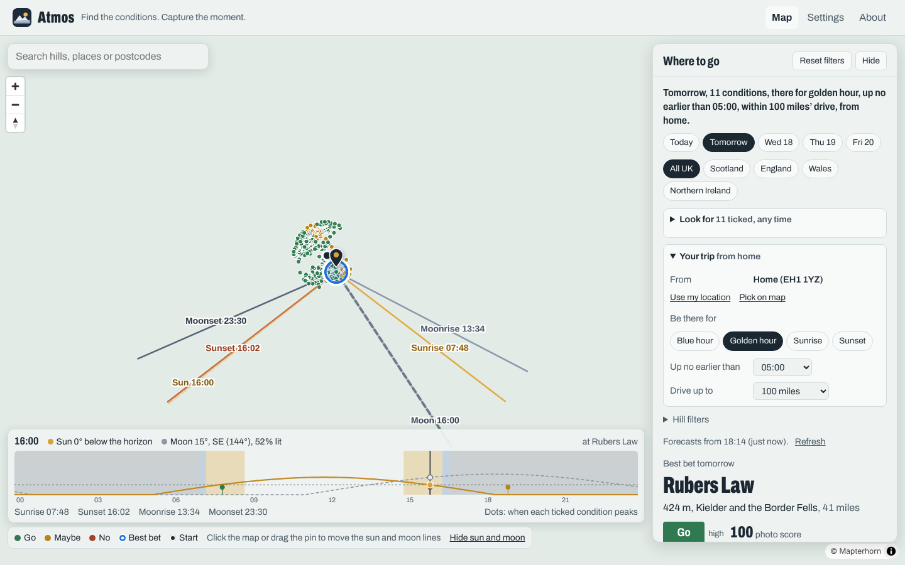

<p align="center">
  
</p>

<h1 align="center">Atmos</h1>

<p align="center"><strong>Find the conditions. Capture the moment.</strong></p>

<p align="center">
  Where to go in the UK for landscape photography and hill walking over the next five days,<br>
  when to leave, and why.
</p>

<p align="center">
  
</p>

> **A guide, not a safety service.** Always check the [Met Office mountain forecast](https://www.metoffice.gov.uk/weather/specialist-forecasts/mountain)
> and [MWIS](https://www.mwis.org.uk/) before going onto the hills.

## What it does

- **Scores every hill for every condition.** About 2,200 UK hills (Munros, Corbetts, Grahams,
  Donalds, Hewitts, Nuttalls, Wainwrights and Marilyns) are scored morning, daytime, evening and
  night, from Met Office and ECMWF forecasts.
- **Ranks them by a photo score.** Tick the conditions and times you care about; each hill gets
  a score out of 100 from its best three, and the list sorts best to worst. The best bet is ringed
  on the map.
- **Explains every verdict.** Pick a hill to see each condition with its weather reasons, how
  closely the models agree, and the air above the valley.
- **Plans the trip.** Set a home, say what to be there for (blue hour, golden hour, sunrise or
  sunset), the earliest you'll get up and how far you'll drive. Each hill gets a rough get-up and
  leave time, with a Google Maps link for the real route.
- **Shows the sun and moon.** A draggable pin draws sunrise, sunset, moonrise and moonset bearings;
  the timeline adds the sun and moon now, and you scrub it through the day.
- **Finds anywhere.** Search hills, UK places and postcodes. Every other UK hill in the database
  (mostly Tumps, such as Ben A'an) can be searched and scored without cluttering the map.

| Condition group | Conditions                                                           |
| --------------- | -------------------------------------------------------------------- |
| Light and sky   | Golden-hour sky, dramatic light, clear air and long views            |
| Cloud and water | Cloud inversion, valley mist, still reflections, waterfalls in spate |
| Winter          | Snow on the tops, hoar frost                                         |
| Night           | Milky Way and stars, aurora (NOAA Kp forecast)                       |
| On foot         | Hill walking (not in the photo score unless ticked)                  |

<table>
  <tr>
    <td width="50%"></td>
    <td width="50%"></td>
  </tr>
  <tr>
    <td>A hill's conditions in the panel, with the sun and moon from its pin.</td>
    <td>The best bet, when to leave, and the ranked list.</td>
  </tr>
</table>

## How it works

A fully static site: the browser fetches forecasts directly from free, keyless public APIs, and
the host only serves files. Summit conditions (inversion, snow, clear air, walking) are judged at
each summit's height from the vertical profile; the rest come from the area's valley forecast.
Thresholds and weights live in `config/profiles.yaml`. Drive times are estimates from
straight-line distance and typical road speeds; walk-ins use Naismith's rule.

## Repository layout

```
apps/web/            SvelteKit 3 static app
packages/engine/     pure TypeScript scoring engine: profiles, factor ramps, vertical interpolation, verdicts
packages/data-client/ Open-Meteo requests, response parsing, batching and caching
config/              zones, photo spots, scoring profiles, hill lists, attributions (YAML, the source of truth)
scripts/             build-time data pipeline (`pnpm build:data`)
data/raw/            hand-downloaded source data, never committed
data/generated/      output of the pipeline, never committed
docker/              Dockerfile, nginx config and the container start-up script
tools/spike/         browser check of every live data source (open the HTML file in a browser)
```

## Development

Requires Node 22 and pnpm (via Corepack: `corepack enable`).

```sh
pnpm install
pnpm check                          # lint, format check, typecheck, tests
DOBIH_VERSION=18.6 pnpm build       # data pipeline + static site into apps/web/build
pnpm dev                            # dev server (run the build once first for the data)
```

Both builds need the DoBIH CSV at `data/raw/DoBIH.csv`: see [data/raw/README.md](data/raw/README.md).

## Running on the NAS

The image is built by GitHub Actions on every merge to `main` and published as
`ghcr.io/rorymarland/atmos:latest`. The NAS needs only three files in one folder:

```
atmos/
├── docker-compose.yml   from this repository
├── .env                 from .env.example
└── DoBIH_v18_6.csv      the hills database download (keep its name)
```

```sh
docker compose up -d                          # first run
docker compose pull && docker compose up -d   # update to the latest version
```

The folder is mounted read-only; each time the container starts it builds the hill data from the
CSV (about two seconds) and writes the display defaults from `.env`. A new DoBIH release only
needs the new CSV in place of the old one and `docker compose restart`.

Point an Nginx Proxy Manager proxy host at `http://<nas>:ATMOS_PORT`, or use the shared proxy
network option commented in `docker-compose.yml`. Serve it over HTTPS if you want "Use my location"
to work: browsers only share location with secure sites. "Pick on map" works either way.

To build the image from a checkout instead:
`docker compose -f docker-compose.yml -f docker-compose.build.yml up -d --build`.

## Data and attribution

| Source                                                                                               | Use                                    | Licence / terms                               |
| ---------------------------------------------------------------------------------------------------- | -------------------------------------- | --------------------------------------------- |
| [Open-Meteo](https://open-meteo.com/) (UK Met Office, ECMWF, DWD ICON models)                        | Forecasts, fetched live by the browser | CC BY 4.0; free API is for non-commercial use |
| [Database of British and Irish Hills](https://www.hills-database.co.uk/) (DoBIH)                     | Hill names, heights, positions, lists  | CC BY 4.0                                     |
| [Postcodes.io](https://postcodes.io/) (OS, Royal Mail and ONS data)                                  | Finding home from a postcode           | OGL v3.0                                      |
| [GeoNames](https://www.geonames.org/) via Open-Meteo geocoding                                       | Finding home from a place name         | CC BY 4.0                                     |
| [NOAA SWPC](https://www.swpc.noaa.gov/)                                                              | Kp forecast for the aurora             | Public domain                                 |
| [OpenStreetMap](https://www.openstreetmap.org/copyright) via [OpenFreeMap](https://openfreemap.org/) | Basemap                                | ODbL                                          |
| [Mapterhorn](https://mapterhorn.com/attribution)                                                     | Hillshade terrain                      | Open data; see the attribution page           |

## Licence

Atmos is source-available under the [PolyForm Noncommercial License 1.0.0](LICENSE). You may use,
copy and modify it for any non-commercial purpose; commercial use is not permitted. This matches the
terms of the free data services it depends on.
